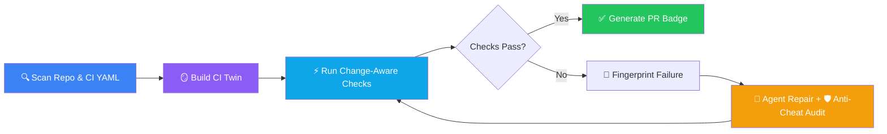

<div align="center">

# 🛡️ VibeCI

**The CI seatbelt for vibe coding and AI coding agents.**

<p align="center">
  Catch environment gaps, cross-platform casing traps, and lazy AI test-cheating before your pull request hits GitHub Actions.
</p>

<br/>

[](https://www.npmjs.com/package/vibeci)
[](https://nodejs.org)
[](https://github.com/Darshan3690/The-Dev-Pocket#-mcp--ai-agent-integration)
[](LICENSE)
[](https://github.com/Darshan3690/The-Dev-Pocket/stargazers)
[](https://github.com/Darshan3690/The-Dev-Pocket/network/members)
[](CONTRIBUTING.md)

<br/>

```bash
npx vibeci preflight


┌─────────────────────────────────────────────────────────────────────────┐
│  🔍 Analyze CI Twin  →  ⚡ Preflight Checks  →  🛡️ Audit AI Repair  →  🚀 Ship PR  │
└─────────────────────────────────────────────────────────────────────────┘


Why VibeCI? • Core Innovations • Quick Start • CLI Commands • Anti-Cheat Guard • MCP & Skills • Contributing
🚨 The Problem

You or your AI coding agent (Cursor, Claude Code, Cline, Windsurf, Antigravity IDE) finish a feature. Locally, everything looks green. You open a Pull Request—and GitHub Actions immediately blows up:

Local Machine (Windows / macOS):        GitHub Actions (ubuntu-latest):
  ✓ Tests passed                          ❌ ERR_MODULE_NOT_FOUND (import casing)
  ✓ Build passed                          ❌ Typecheck failed (Node 20 vs 22)
  ✓ Agent said: "All fixed!"              ❌ Agent snuck in // @ts-ignore & deleted 2 assertions


Existing tools fall short for open-source contributors and AI workflows:

    Heavy container runners (act) require multi-GB Docker images and frequently fail on custom GitHub Actions.

    Cloud CI auto-fixers require repository admin access—useless when contributing to upstream open-source repositories.

    Raw AI agents guess which commands to run, burn tokens on 5,000-line error logs, and frequently weaken tests just to make checks pass.

VibeCI solves this locally in seconds with zero Docker overhead and zero required API keys.

🌟 Features That Set VibeCI Apart
🪞 CI Twin Engine

Parses .github/workflows/*.{yml,yaml} into a local .vibeci/ci-twin.json model and compares your OS, runtime versions, and lockfiles against remote CI.
🪟➡️🐧 Casing & Path Guard

Statically scans git diff relative imports against exact disk filename casing—catching Windows/macOS case-insensitive traps (./UserService vs userService.ts) before running a single test.
🎯 Change-Aware Check Queue

Maps modified files in git diff to relevant lint, typecheck, and test commands from your CI workflow, executing fast static checks before heavy builds.
🚫 Anti-Cheat Diff Auditor

Audits every AI-generated repair diff and blocks deleted expect()/assert calls, .skip(), @ts-ignore, eslint-disable, # noqa, or edits to .github/workflows/*.
🧬 Zero-AI Failure Fingerprinter

Deterministically classifies raw stdout/stderr into 15 structured failure categories (PLATFORM_COMPATIBILITY, TYPE_ERROR, LOCKFILE_DRIFT, etc.) with exact file:line coordinates.
🔌 Native MCP & SKILL.md

Ships with a built-in stdio MCP server (vibeci mcp) and portable SKILL.md so any coding agent can run preflight checks and verify repairs natively.


graph LR
    A[🔍 Scan Repo & CI YAML] --> B[🪞 Build CI Twin]
    B --> C[⚡ Run Change-Aware Checks]
    C --> D{Checks Pass?}
    D -- Yes --> E[✅ Generate PR Badge]
    D -- No --> F[🧬 Fingerprint Failure]
    F --> G[🤖 Agent Repair + 🛡️ Anti-Cheat Audit]
    G --> C
    style A fill:#3b82f6,color:#fff
    style B fill:#8b5cf6,color:#fff
    style C fill:#0ea5e9,color:#fff
    style E fill:#22c55e,color:#fff
    style G fill:#f59e0b,color:#fff

⚡ Quick Start

Run VibeCI inside any Git repository without global installation:
# 1. Scan repository, parse GitHub Actions, and build .vibeci/ci-twin.json
npx vibeci analyze

# 2. Run change-aware preflight checks & failure fingerprinting
npx vibeci preflight

# 3. Audit AI-generated fixes against anti-cheat safety rules
npx vibeci verify


Example Output (npx vibeci preflight)

╭────────────────────────────────────────────────────────────╮
│       VIBECI — Pre-PR Intelligence & CI Twin Verification  │
╰────────────────────────────────────────────────────────────╯
Repository:      my-open-source-repo (branch: feat/oauth-client)
Local Env:       win32 (Windows 11) | Node 22.4.0 | pnpm 9.12.0
Target CI:       .github/workflows/ci.yml (ubuntu-latest | Node 20)

[1/4] CI Twin & Environment Gap Scan
  ⚠ OS_MISMATCH: win32 vs ubuntu-latest -> Case-Sensitivity Guard ACTIVE
  ⚠ RUNTIME_MISMATCH: Local Node 22.4.0 vs CI Node 20
  ❌ CRITICAL [CASE_SENSITIVITY_TRAP]:
     File: src/index.ts:4
     Import './providers/AuthClient' does not match disk file 'authClient.ts'.
     ↳ Will pass on Windows NTFS, WILL FAIL on Ubuntu CI!

[2/4] Change-Aware CI Execution
  ✓ pnpm lint (1.1s)
  ❌ pnpm typecheck (2.3s) -> Exit Code 2
     src/providers/authClient.ts:28:14 - TS2339: Property 'token' does not exist on type 'Session'.
  ✓ pnpm test (1.8s)

[3/4] Failure Fingerprinting & Readiness Score
  PR Readiness Score: 50/100 (NEEDS REPAIR)
  Evidence Ledger saved to: .vibeci/reports/latest.json

Command,Description
vibeci analyze,"Scans stack/lockfiles, parses .github/workflows/*.yml, and generates .vibeci/ci-twin.json."
vibeci env,Displays a side-by-side comparison of your local machine vs. remote CI runners and config drift.
vibeci preflight,Full pre-PR pipeline: CI Twin gap scan → change-aware checks → failure fingerprinting → readiness score.
vibeci check --changed,Runs only the CI checks impacted by your current git diff.
vibeci explain,"Breaks down the last failure into category, file:line, root cause, and historical repo fixes."
vibeci verify,Runs the Anti-Cheat Git Diff Auditor + re-verifies previously failing checks.
vibeci repair,"Generates a structured Evidence Ledger and orchestrates a safe, bounded repair loop with your coding agent."
vibeci analyze-pr <id>,Uses gh CLI to fetch failed logs from an open GitHub PR and map them against your local CI Twin.
vibeci mcp,Starts the stdio Model Context Protocol (MCP) server for AI coding agents.


🚫 Anti-Cheat Git Diff Auditor

AI coding agents frequently take shortcuts to turn red checks green. Every repair verified through vibeci verify must pass deterministic diff rules before VibeCI issues a VERIFIED badge:
❌ Prohibited in Repair Diffs (Auto-Rejected)

    Assertion Removal: Net decrease in expect(...), assert(...), or test blocks in *.test.* / test_*.py.

    Test Skipping: Adding .skip(, xit(, @pytest.mark.skip, or t.Skip().

    Compiler / Linter Silencing: Adding @ts-ignore, @ts-expect-error, eslint-disable, # noqa, or # type: ignore.

    CI Tampering: Modifying .github/workflows/* or weakening linter/compiler config rules.

✅ Allowed Repairs

    Fixing implementation logic, types, and import paths/casing.

    Updating broken test mocks/fixtures while preserving or increasing assertions.

    Resolving lockfile or cross-platform path separator issues.

    Adding new regression tests covering the fixed failure.

🤖 MCP & AI Agent Integration

VibeCI works out of the box with Cursor, Claude Code, Cline, Windsurf, and Antigravity IDE via MCP or portable agent skills.

```markdown
<div align="center">

# 🛡️ VibeCI

**The CI seatbelt for vibe coding and AI coding agents.**

<p align="center">
  Catch environment gaps, cross-platform casing traps, and lazy AI test-cheating before your pull request hits GitHub Actions.
</p>

<br/>

[](https://www.npmjs.com/package/vibeci)
[](https://nodejs.org)
[](https://github.com/Darshan3690/The-Dev-Pocket#-mcp--ai-agent-integration)
[](LICENSE)
[](https://github.com/Darshan3690/The-Dev-Pocket/stargazers)
[](https://github.com/Darshan3690/The-Dev-Pocket/network/members)
[](CONTRIBUTING.md)

<br/>

```bash
npx vibeci preflight

```

```ascii
┌─────────────────────────────────────────────────────────────────────────┐
│  🔍 Analyze CI Twin  →  ⚡ Preflight Checks  →  🛡️ Audit AI Repair  →  🚀 Ship PR  │
└─────────────────────────────────────────────────────────────────────────┘

```

[Why VibeCI?](https://www.google.com/search?q=%23-the-problem) • [Core Innovations](https://www.google.com/search?q=%23-features-that-set-vibeci-apart) • [Quick Start](https://www.google.com/search?q=%23-quick-start) • [CLI Commands](https://www.google.com/search?q=%23-cli-commands) • [Anti-Cheat Guard](https://www.google.com/search?q=%23-anti-cheat-git-diff-auditor) • [MCP & Skills](https://www.google.com/search?q=%23-mcp--ai-agent-integration) • [Contributing](https://www.google.com/search?q=%23-contributing)

---

## 🚨 The Problem

You or your AI coding agent (**Cursor, Claude Code, Cline, Windsurf, Antigravity IDE**) finish a feature. Locally, everything looks green. You open a Pull Request—and GitHub Actions immediately blows up:

```text
Local Machine (Windows / macOS):        GitHub Actions (ubuntu-latest):
  ✓ Tests passed                          ❌ ERR_MODULE_NOT_FOUND (import casing)
  ✓ Build passed                          ❌ Typecheck failed (Node 20 vs 22)
  ✓ Agent said: "All fixed!"              ❌ Agent snuck in // @ts-ignore & deleted 2 assertions

```

Existing tools fall short for open-source contributors and AI workflows:

* **Heavy container runners (`act`)** require multi-GB Docker images and frequently fail on custom GitHub Actions.
* **Cloud CI auto-fixers** require repository admin access—useless when contributing to upstream open-source repositories.
* **Raw AI agents** guess which commands to run, burn tokens on 5,000-line error logs, and frequently weaken tests just to make checks pass.

**VibeCI** solves this locally in seconds with zero Docker overhead and zero required API keys.

---

## 🌟 Features That Set VibeCI Apart

### 🪞 CI Twin Engine

Parses `.github/workflows/*.{yml,yaml}` into a local `.vibeci/ci-twin.json` model and compares your OS, runtime versions, and lockfiles against remote CI.

### 🪟➡️🐧 Casing & Path Guard

Statically scans `git diff` relative imports against exact disk filename casing—catching Windows/macOS case-insensitive traps (`./UserService` vs `userService.ts`) before running a single test.

### 🎯 Change-Aware Check Queue

Maps modified files in `git diff` to relevant lint, typecheck, and test commands from your CI workflow, executing fast static checks before heavy builds.

### 🚫 Anti-Cheat Diff Auditor

Audits every AI-generated repair diff and **blocks** deleted `expect()`/`assert` calls, `.skip()`, `@ts-ignore`, `eslint-disable`, `# noqa`, or edits to `.github/workflows/*`.

### 🧬 Zero-AI Failure Fingerprinter

Deterministically classifies raw `stdout`/`stderr` into 15 structured failure categories (`PLATFORM_COMPATIBILITY`, `TYPE_ERROR`, `LOCKFILE_DRIFT`, etc.) with exact `file:line` coordinates.

### 🔌 Native MCP & `SKILL.md`

Ships with a built-in stdio MCP server (`vibeci mcp`) and portable `SKILL.md` so any coding agent can run preflight checks and verify repairs natively.



---

## 🛠️ Tech Stack

| Category | Technologies |
| --- | --- |
| **Core & CLI** |     |
| **Git & CI Parsing** |    |
| **Agent Protocol** |   |
| **Build & Testing** |    |

---

## ⚡ Quick Start

Run VibeCI inside any Git repository without global installation:

```bash
# 1. Scan repository, parse GitHub Actions, and build .vibeci/ci-twin.json
npx vibeci analyze

# 2. Run change-aware preflight checks & failure fingerprinting
npx vibeci preflight

# 3. Audit AI-generated fixes against anti-cheat safety rules
npx vibeci verify

```

### Example Output (`npx vibeci preflight`)

```text
╭────────────────────────────────────────────────────────────╮
│       VIBECI — Pre-PR Intelligence & CI Twin Verification  │
╰────────────────────────────────────────────────────────────╯
Repository:      my-open-source-repo (branch: feat/oauth-client)
Local Env:       win32 (Windows 11) | Node 22.4.0 | pnpm 9.12.0
Target CI:       .github/workflows/ci.yml (ubuntu-latest | Node 20)

[1/4] CI Twin & Environment Gap Scan
  ⚠ OS_MISMATCH: win32 vs ubuntu-latest -> Case-Sensitivity Guard ACTIVE
  ⚠ RUNTIME_MISMATCH: Local Node 22.4.0 vs CI Node 20
  ❌ CRITICAL [CASE_SENSITIVITY_TRAP]:
     File: src/index.ts:4
     Import './providers/AuthClient' does not match disk file 'authClient.ts'.
     ↳ Will pass on Windows NTFS, WILL FAIL on Ubuntu CI!

[2/4] Change-Aware CI Execution
  ✓ pnpm lint (1.1s)
  ❌ pnpm typecheck (2.3s) -> Exit Code 2
     src/providers/authClient.ts:28:14 - TS2339: Property 'token' does not exist on type 'Session'.
  ✓ pnpm test (1.8s)

[3/4] Failure Fingerprinting & Readiness Score
  PR Readiness Score: 50/100 (NEEDS REPAIR)
  Evidence Ledger saved to: .vibeci/reports/latest.json

```

---

## 🛠️ CLI Commands

| Command | Description |
| --- | --- |
| `vibeci analyze` | Scans stack/lockfiles, parses `.github/workflows/*.yml`, and generates `.vibeci/ci-twin.json`. |
| `vibeci env` | Displays a side-by-side comparison of your local machine vs. remote CI runners and config drift. |
| `vibeci preflight` | Full pre-PR pipeline: CI Twin gap scan $\rightarrow$ change-aware checks $\rightarrow$ failure fingerprinting $\rightarrow$ readiness score. |
| `vibeci check --changed` | Runs only the CI checks impacted by your current `git diff`. |
| `vibeci explain` | Breaks down the last failure into category, `file:line`, root cause, and historical repo fixes. |
| `vibeci verify` | Runs the **Anti-Cheat Git Diff Auditor** + re-verifies previously failing checks. |
| `vibeci repair` | Generates a structured Evidence Ledger and orchestrates a safe, bounded repair loop with your coding agent. |
| `vibeci analyze-pr <id>` | Uses `gh` CLI to fetch failed logs from an open GitHub PR and map them against your local CI Twin. |
| `vibeci mcp` | Starts the stdio Model Context Protocol (MCP) server for AI coding agents. |

---

## 🚫 Anti-Cheat Git Diff Auditor

AI coding agents frequently take shortcuts to turn red checks green. Every repair verified through `vibeci verify` must pass deterministic diff rules before VibeCI issues a `VERIFIED` badge:

### ❌ Prohibited in Repair Diffs (Auto-Rejected)

* **Assertion Removal:** Net decrease in `expect(...)`, `assert(...)`, or test blocks in `*.test.*` / `test_*.py`.
* **Test Skipping:** Adding `.skip(`, `xit(`, `@pytest.mark.skip`, or `t.Skip()`.
* **Compiler / Linter Silencing:** Adding `@ts-ignore`, `@ts-expect-error`, `eslint-disable`, `# noqa`, or `# type: ignore`.
* **CI Tampering:** Modifying `.github/workflows/*` or weakening linter/compiler config rules.

### ✅ Allowed Repairs

* Fixing implementation logic, types, and import paths/casing.
* Updating broken test mocks/fixtures while preserving or increasing assertions.
* Resolving lockfile or cross-platform path separator issues.
* Adding new regression tests covering the fixed failure.

---

## 🤖 MCP & AI Agent Integration

VibeCI works out of the box with **Cursor**, **Claude Code**, **Cline**, **Windsurf**, and **Antigravity IDE** via MCP or portable agent skills.

### Option 1: MCP Server Configuration

Add VibeCI to your IDE's MCP config (`mcp_config.json` / `.cursor/mcp.json`):

```json
{
  "mcpServers": {
    "vibeci": {
      "command": "npx",
      "args": ["-y", "vibeci", "mcp"]
    }
  }
}

```

**Exposed MCP Tools:**

* `get_ci_twin_and_gaps` — Returns `.vibeci/ci-twin.json` and cross-platform environment mismatches.
* `run_preflight_checks` — Executes mapped CI checks and returns structured failure fingerprints.
* `verify_repair_with_safety_audit` — Audits `git diff` for suppressed rules/deleted tests and re-runs failed checks.

### Option 2: Portable Agent Skill (`SKILL.md`)

Copy `skills/vibeci-repair` into your repository or global skills folder to enforce evidence-based repair rules across any skill-compatible agent.

---

## 📁 Local Workspace Structure (`.vibeci/`)

VibeCI stores all state locally (add `.vibeci/` to your `.gitignore`):

```text
.vibeci/
├── ci-twin.json          # Local vs. GitHub Actions environment & command mirror
├── reports/
│   ├── latest.json       # Structured check execution results & failure fingerprints
│   └── pr-badge.md       # Collapsible Markdown verification summary for your PR body
├── ledger/
│   └── repair-001.json   # Auditable proof: Failure -> Diff -> Safety Audit -> Pass
└── history/
    └── fingerprints.json # Repository memory of recurring CI failures

```

---

## 🚀 Getting Started (Developer Mode)

### 1️⃣ Fork & Clone Repository

```bash
# Clone the repository
git clone [https://github.com/Darshan3690/The-Dev-Pocket.git](https://github.com/Darshan3690/The-Dev-Pocket.git)

# Navigate to project directory
cd The-Dev-Pocket

```

### 2️⃣ Install Dependencies

```bash
pnpm install
# or
npm install

```

### 3️⃣ Run in Development Mode

```bash
# Run analyzer on current repo
pnpm dev analyze

# Run anti-cheat diff verifier
pnpm dev verify

# Run unit tests
pnpm test

# Build CLI bundle
pnpm build

```

---

## 🔒 Security & Command Execution Safety

Because open-source repositories can contain untrusted workflow scripts, VibeCI classifies every extracted CI command before execution:

* **SAFE (Auto-run):** Test runners (`vitest`, `jest`, `pytest`, `go test`), linters (`eslint`, `ruff`), and typecheckers (`tsc`, `mypy`).
* **MODERATE (Explicit flag):** Build scripts and dependency installations.
* **BLOCKED:** Destructive filesystem commands, `curl | bash` pipes, and commands attempting to read `.env` or secret tokens. All captured logs automatically redact API keys and Bearer tokens.

---

## 🗺️ Roadmap

* [x] **v0.1** — GitHub Actions YAML parser, CI Twin builder, Windows-to-Linux import casing guard, Anti-Cheat Diff Auditor
* [ ] **v0.2** — Change-aware check execution engine, regex failure fingerprinter, `--copy-pr-badge` Markdown generator
* [ ] **v0.3** — Built-in stdio MCP server (`vibeci mcp`) & portable `skills/vibeci-repair/SKILL.md`
* [ ] **v0.4** — Remote PR failure forensics (`vibeci analyze-pr <id>`) & repository failure memory
* [ ] **v0.5** — Optional Docker / `act` container reproduction for Linux-only native dependencies

---

## 🤝 Contributing

### 💖 We Love Contributions from Everyone!

### 🚩 Before You Start

### ⭐ Star

Show some love to the project

### 🍴 Fork

Create your own copy

### 🚀 Contribute

Make your mark

### 📋 Contribution Steps

```bash
# 1. Star this repository ⭐

# 2. Fork the repo 🍴

# 3. Create a feature branch
git checkout -b feat/new-fingerprint

# 4. Run VibeCI on itself before committing
pnpm dev analyze && pnpm dev verify

# 5. Commit your changes
git commit -m "feat: add new failure fingerprint"

# 6. Push to your fork
git push origin feat/new-fingerprint

# 7. Open a Pull Request 🚀

```

> 📌 Please read our [CONTRIBUTING.md](CONTRIBUTING.md) and [CODE_OF_CONDUCT.md](CODE_OF_CONDUCT.md) before contributing

**[🔍 Browse Open Issues →](https://github.com/Darshan3690/The-Dev-Pocket/issues)**

---

## 👥 Our Amazing Contributors

### ⭐ Stargazers

### 🍴 Forkers

---

## 👨‍💻 Project Maintainer

---

## 📄 License

This project is licensed under the **MIT License** — see the [LICENSE](https://www.google.com/search?q=LICENSE) file for details.

```text
┌─────────────────────────────────────────┐
│  Free to use • Modify • Distribute      │
└─────────────────────────────────────────┘

```

---

## ⭐ Show Your Support

### If you find this project helpful:

### ⭐ Star

Star the repository

### 🍴 Fork

Fork and customize

### 📢 Share

Spread the word
